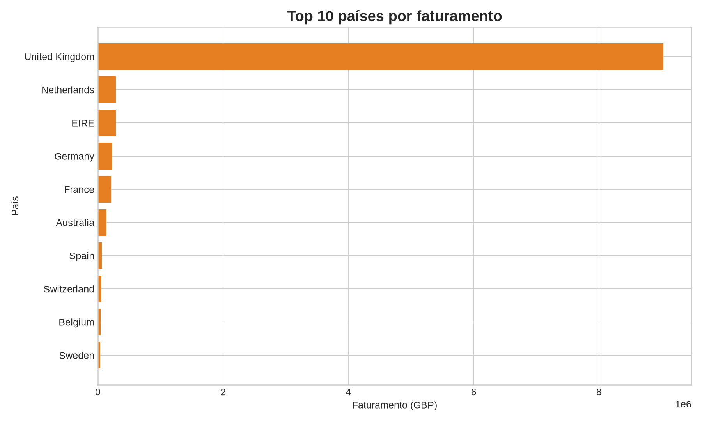
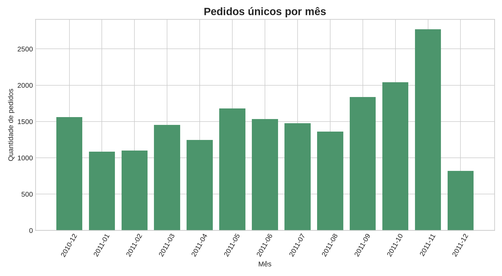

# Vendas e desempenho no varejo online: análise com Python e Power BI

**Projeto de Recuperação — Módulo 2 — Semana 14**
**Aluno:** Yuri Mello Saraiva
**Turma:** Turma 01 — Análise de Dados
**Disciplina:** Visualização de Dados e Business Intelligence [T1]

## 1. Resumo

Este projeto analisa o desempenho de vendas de um varejista online do Reino Unido a partir de dados públicos do UCI Machine Learning Repository. O objetivo é identificar quais períodos, países e produtos concentram maior faturamento e volume de pedidos, gerando evidências para apoiar priorização comercial e acompanhamento gerencial.

A pergunta de negócio é:

> **Quais países, produtos e períodos concentram o maior faturamento e volume de pedidos, e que oportunidades de acompanhamento comercial os dados sugerem?**

A análise não busca explicar causalidade nem avaliar a margem de lucro. Ela descreve o comportamento observado na base disponível.

## 2. Público-alvo e escopo

Os resultados podem apoiar gestores comerciais, responsáveis por planejamento de vendas e equipes de BI. O escopo contempla o período de **01/12/2010 a 09/12/2011**, com foco em faturamento bruto calculado como `Quantity × UnitPrice`, quantidade de itens e pedidos únicos.

O escopo não contempla lucro, custo, margem, estoque, clientes individualizados, previsão de demanda ou avaliação causal de campanhas. O identificador `CustomerID` não é carregado na base tratada porque não é necessário para responder à pergunta e sua remoção reduz a exposição de dados desnecessários.

## 3. Fonte pública e licença

A fonte é o dataset **Online Retail**, disponibilizado pelo [UCI Machine Learning Repository](https://archive.ics.uci.edu/dataset/352/online+retail). A base possui 541.909 registros transacionais, oito variáveis e cobre operações de um varejista online não presencial do Reino Unido entre dezembro de 2010 e dezembro de 2011.

A UCI informa licença **Creative Commons Attribution 4.0 International (CC BY 4.0)**, que permite compartilhamento e adaptação com atribuição adequada. A referência recomendada é: Chen, D. (2015). *Online Retail*. UCI Machine Learning Repository. DOI: [10.24432/C5BW33](https://doi.org/10.24432/C5BW33).

A coleta foi feita por download do arquivo público `Online Retail.xlsx` em 16/11/2026. O arquivo original não é necessário para acompanhar o código no GitHub: o script pode ser executado após o download do arquivo para `data/raw/`.

## 4. Indicadores

- **Faturamento bruto:** soma de `Quantity × UnitPrice`, em GBP.
- **Pedidos únicos:** quantidade de `InvoiceNo` distintos após a filtragem de vendas válidas.
- **Itens vendidos:** soma de `Quantity`.
- **Ticket médio:** média do faturamento por pedido.
- **Faturamento por país, produto e mês:** permite identificar concentração comercial e períodos de maior movimentação.

## 5. Pipeline de dados

### Extração

O arquivo Excel é lido com `pandas.read_excel()` e `openpyxl`. A origem, o período, os campos e a licença estão documentados neste README.

### Transformação

1. Padronização de nomes e textos.
2. Conversão de `InvoiceDate` para data e hora.
3. Conversão de `Quantity` e `UnitPrice` para valores numéricos.
4. Identificação de cancelamentos quando `InvoiceNo` começa com `C`.
5. Criação de `Revenue = Quantity × UnitPrice`.
6. Exclusão dos cancelamentos e das linhas com quantidade ou preço não positivos.
7. Exclusão de registros sem data válida ou descrição utilizável.
8. Criação de dimensões de ano, mês e ano-mês.
9. Remoção de `CustomerID` do arquivo final por minimização de dados: ele não é necessário para os indicadores agregados.

A decisão de excluir cancelamentos e valores não positivos evita que devoluções ou registros inválidos reduzam artificialmente o faturamento bruto dos KPIs principais. Os cancelamentos continuam contabilizados no diagnóstico de qualidade.

### Carga

O pipeline salva os seguintes arquivos em `data/processed/`:

- `vendas_tratadas.csv`: base de vendas válida, pronta para importação no Power BI;
- `vendas_mensais.csv`: indicadores agregados por mês;
- `vendas_por_pais.csv`: indicadores agregados por país;
- `top_produtos.csv`: ranking dos 20 produtos por faturamento;
- `indicadores.json`: KPIs gerais;
- `resumo_analitico.txt`: resumo para conferência.

## 6. Resultados encontrados

Após o tratamento, foram identificados **530.104 registros de venda válidos**, **19.960 pedidos únicos**, **5.588.376 itens vendidos** e **£10.666.684,54 de faturamento bruto**. O ticket médio calculado por pedido foi de **£534,40**.

O **Reino Unido** concentrou **£9.025.222,08**, aproximadamente 84,6% do faturamento válido calculado. Os países seguintes foram Países Baixos, EIRE, Alemanha e França. Esse resultado indica forte concentração geográfica na operação observada e sugere acompanhar separadamente o mercado doméstico e os mercados internacionais.

Entre os produtos, aparecem no topo por faturamento itens como `REGENCY CAKESTAND 3 TIER`, `PAPER CRAFT, LITTLE BIRDIE`, `WHITE HANGING HEART T-LIGHT HOLDER` e `PARTY BUNTING`. O produto `PAPER CRAFT, LITTLE BIRDIE` deve ser interpretado com cautela, pois possui grande quantidade registrada em apenas um pedido, o que recomenda validação operacional antes de transformá-lo em decisão comercial.

Os gráficos gerados estão em `outputs/figures/`:







## 7. Recomendações

1. Acompanhar o Reino Unido como mercado principal em um painel separado, mantendo uma visão comparativa dos mercados internacionais.
2. Monitorar mensalmente faturamento, pedidos únicos e ticket médio para identificar períodos de pico e queda.
3. Validar os produtos líderes junto ao cadastro e à operação, especialmente quando o faturamento estiver concentrado em poucos pedidos.
4. Evoluir a análise com custo, margem, estoque e devoluções caso esses dados públicos ou autorizados estejam disponíveis em uma etapa futura.

Estas recomendações são hipóteses de uso gerencial baseadas em concentração e comportamento observado. A análise não demonstra que país, produto ou período cause o resultado.

## 8. Relatório Power BI

O relatório deve conter, no mínimo, uma página de visão geral com:

- cartões de faturamento, pedidos, itens e ticket médio;
- gráfico de linha de faturamento por mês;
- gráfico de barras de faturamento por país;
- ranking de produtos;
- segmentadores para período, país e produto;
- caixa de texto com fonte, período, moeda e limitações.

Como o Power BI Desktop não está disponível neste ambiente, o arquivo `.pbix` precisa ser criado ou salvo no computador do aluno. O roteiro detalhado, as medidas DAX e os campos recomendados estão em [`docs/POWER_BI_GUIA.md`](docs/POWER_BI_GUIA.md). As imagens em `outputs/figures/` são evidências analíticas produzidas em Python; não substituem o arquivo `.pbix` exigido pelo professor.

## 9. Como executar

Requisitos: Python 3.10 ou superior.

```bash
python -m venv .venv
# Linux/macOS
source .venv/bin/activate
# Windows PowerShell
# .venv\\Scripts\\Activate.ps1

pip install -r requirements.txt
python src/analise_vendas.py
```

Antes de executar, baixe o arquivo `Online Retail.xlsx` na página da UCI e coloque-o em `data/raw/`. O script não usa credenciais, tokens nem caminhos absolutos.

## 10. Estrutura do repositório

```text
data/raw/                 # arquivo público de entrada, quando permitido
 data/processed/           # saídas tratadas e agregadas
src/analise_vendas.py      # ETL, indicadores e gráficos
outputs/figures/           # visualizações geradas
powerbi/                   # espaço reservado para o .pbix e evidências
 docs/POWER_BI_GUIA.md     # roteiro para montar o relatório
requirements.txt           # dependências Python
.gitignore                 # arquivos locais e temporários
README.md                  # documentação principal
```

## 11. Limitações e melhorias futuras

A base está em GBP e não informa custos ou margem. A análise considera faturamento bruto, não lucro. Os dados são históricos e terminam em 09/12/2011; portanto, não devem ser usados para descrever o mercado atual sem atualização. Alguns produtos apresentam concentração atípica em poucos pedidos, o que exige validação. Uma evolução seria incluir calendário comercial, margem, devoluções, estoque e uma camada de qualidade automatizada.

## 12. Tecnologias e referências

- Python, pandas, openpyxl e matplotlib.
- Power BI Desktop para o relatório interativo.
- [UCI Machine Learning Repository — Online Retail](https://archive.ics.uci.edu/dataset/352/online+retail).
- [Licença CC BY 4.0](https://creativecommons.org/licenses/by/4.0/).

## 13. Links de entrega

- Repositório pessoal: `https://github.com/matadreams/Miniprojeto_YURI_MELLO_T1`
- Repositório oficial da turma: inserir o link ou procedimento indicado pelo professor.
- Power BI Service: opcional; inserir somente se o relatório for publicado e o acesso estiver autorizado.
- Vídeo: opcional.

**Importante:** antes de enviar no AVA, faça o último commit, confira se o README abre corretamente, valide se não existem credenciais no histórico e não altere o repositório depois da submissão, salvo orientação do professor.
