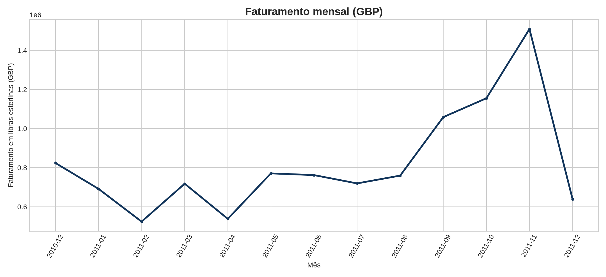
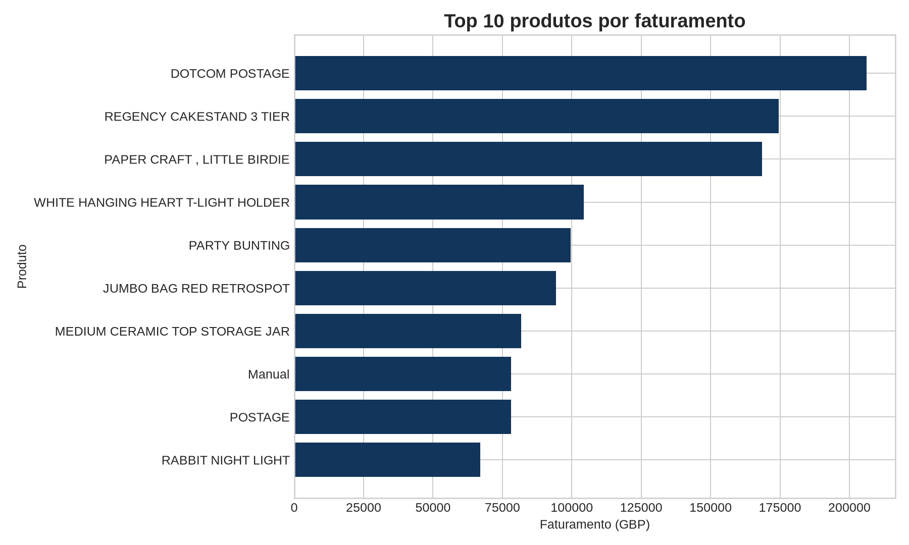

# Vendas e desempenho no varejo online: análise com Python e dashboard HTML

**Projeto de Recuperação — Módulo 2 — Semana 14**
**Aluno:** Yuri Mello Saraiva
**Turma:** Turma 01 — Análise de Dados
**Disciplina:** Visualização de Dados e Business Intelligence [T1]

## 1. Resumo

Este projeto analisa o desempenho de vendas de um varejista online do Reino Unido a partir de dados públicos do UCI Machine Learning Repository. O objetivo é identificar quais períodos, países e produtos concentram maior faturamento e volume de pedidos, gerando evidências para apoiar priorização comercial e acompanhamento gerencial.

A pergunta de negócio é:

> **Quais países, produtos e períodos concentram o maior faturamento e volume de pedidos, e que oportunidades de acompanhamento comercial os dados sugerem?**

A análise não busca explicar causalidade nem avaliar a margem de lucro. Ela descreve o comportamento observado na base disponível.

## 2. Público-alvo e escopo

Os resultados podem apoiar gestores comerciais, responsáveis por planejamento de vendas e equipes de BI. O escopo contempla o período de **01/12/2010 a 09/12/2011**, com foco em faturamento bruto calculado como `Quantity × UnitPrice`, quantidade de itens e pedidos únicos.

O escopo não contempla lucro, custo, margem, estoque, clientes individualizados, previsão de demanda ou avaliação causal de campanhas. O identificador `CustomerID` não é carregado na base tratada porque não é necessário para responder à pergunta e sua remoção reduz a exposição de dados desnecessários.

## 3. Fonte pública e licença

A fonte é o dataset **Online Retail**, disponibilizado pelo [UCI Machine Learning Repository](https://archive.ics.uci.edu/dataset/352/online+retail). A base possui 541.909 registros transacionais, oito variáveis e cobre operações de um varejista online não presencial do Reino Unido entre dezembro de 2010 e dezembro de 2011.

A UCI informa licença **Creative Commons Attribution 4.0 International (CC BY 4.0)**, que permite compartilhamento e adaptação com atribuição adequada. A referência recomendada é: Chen, D. (2015). *Online Retail*. UCI Machine Learning Repository. DOI: [10.24432/C5BW33](https://doi.org/10.24432/C5BW33).

A coleta foi feita por download do arquivo público `Online Retail.xlsx` em 16/11/2026. O arquivo original não é necessário para abrir o dashboard já gerado, mas é necessário para reproduzir o ETL.

## 4. Indicadores

- **Faturamento bruto:** soma de `Quantity × UnitPrice`, em GBP.
- **Pedidos únicos:** quantidade de `InvoiceNo` distintos após a filtragem de vendas válidas.
- **Itens vendidos:** soma de `Quantity`.
- **Ticket médio:** média do faturamento por pedido.
- **Faturamento por país, produto e mês:** permite identificar concentração comercial e períodos de maior movimentação.

## 5. Pipeline de dados

### Extração e transformação

O arquivo Excel é lido com `pandas.read_excel()` e `openpyxl`. O pipeline padroniza nomes e textos, converte datas e números, identifica cancelamentos cujo `InvoiceNo` começa com `C`, calcula `Revenue = Quantity × UnitPrice` e exclui cancelamentos, valores não positivos e registros inválidos dos KPIs principais.

O arquivo final não inclui `CustomerID`, pois esse campo não é necessário para a análise agregada. As decisões de limpeza estão documentadas no código `src/analise_vendas.py`.

### Carga

O pipeline salva os arquivos em `data/processed/`:

- `vendas_tratadas.csv`: base válida;
- `vendas_mensais.csv`: agregação mensal;
- `vendas_por_pais.csv`: agregação por país;
- `top_produtos.csv`: ranking de produtos;
- `indicadores.json`: KPIs gerais;
- `resumo_analitico.txt`: resumo para conferência.

## 6. Resultados encontrados

Após o tratamento, foram identificados **530.104 registros de venda válidos**, **19.960 pedidos únicos**, **5.588.376 itens vendidos** e **£10.666.684,54 de faturamento bruto**. O ticket médio calculado por pedido foi de **£534,40**.

O **Reino Unido** concentrou **£9.025.222,08**, aproximadamente 84,6% do faturamento válido calculado. Os países seguintes foram Países Baixos, EIRE, Alemanha e França. Esse resultado indica forte concentração geográfica na operação observada e sugere acompanhar separadamente o mercado doméstico e os mercados internacionais.

Entre os produtos, aparecem no topo por faturamento itens como `REGENCY CAKESTAND 3 TIER`, `PAPER CRAFT, LITTLE BIRDIE`, `WHITE HANGING HEART T-LIGHT HOLDER` e `PARTY BUNTING`. O produto `PAPER CRAFT, LITTLE BIRDIE` deve ser interpretado com cautela, pois possui grande quantidade registrada em apenas um pedido, o que recomenda validação operacional.

## 7. Dashboard interativo HTML

A entrega interativa principal é o arquivo [`dashboard.html`](dashboard.html). Ele funciona diretamente no navegador e contém:

- cartões de faturamento, pedidos, itens e ticket médio;
- filtro por país;
- filtro por período inicial;
- gráfico de faturamento mensal;
- ranking dos 10 produtos por faturamento;
- faturamento por país;
- tabela de produtos, faturamento, itens e pedidos;
- fonte, período, moeda e limitações metodológicas.

Para abrir, baixe o arquivo e abra `dashboard.html` no navegador. O dashboard utiliza Chart.js por CDN; portanto, os gráficos precisam de conexão com a internet na primeira abertura. O arquivo também pode ser publicado pelo GitHub Pages.

A versão HTML substitui o relatório Power BI porque o Power BI Desktop apresentou inconsistências de conversão regional de tipos na importação. O dashboard usa diretamente os dados tratados pelo Python e mantém a rastreabilidade dos indicadores.

As visualizações estáticas de apoio estão em `outputs/figures/`:






## 8. Como executar

Requisitos: Python 3.10 ou superior.

```bash
python -m venv .venv
source .venv/bin/activate          # Linux/macOS
# .venv\\Scripts\\Activate.ps1    # Windows PowerShell
pip install -r requirements.txt
python src/analise_vendas.py
python src/gerar_dashboard_html.py
```

Antes de executar, baixe `Online Retail.xlsx` da página da UCI e coloque-o em `data/raw/`. O script de geração cria ou atualiza `dashboard.html` a partir dos arquivos tratados.

Para testar localmente:

```bash
python -m http.server 8000
```

Depois abra `http://localhost:8000/dashboard.html`.

## 9. Estrutura do repositório

```text
data/raw/                    # arquivo público de entrada
data/processed/              # saídas tratadas e agregadas
src/analise_vendas.py         # ETL, indicadores e gráficos
src/gerar_dashboard_html.py   # geração do dashboard interativo
outputs/figures/              # visualizações estáticas
dashboard.html               # aplicação interativa final
docs/DICIONARIO_DADOS.md      # dicionário dos campos
docs/POWER_BI_GUIA.md         # guia histórico da alternativa Power BI
requirements.txt              # dependências Python
.gitignore                    # arquivos locais e temporários
README.md                     # documentação principal
```

## 10. Limitações e melhorias futuras

A base está em GBP e não informa custos ou margem. A análise considera faturamento bruto, não lucro. Os dados são históricos e terminam em 09/12/2011; portanto, não devem ser usados para descrever o mercado atual sem atualização. Alguns produtos apresentam concentração atípica em poucos pedidos, o que exige validação. Uma evolução seria incluir calendário comercial, margem, devoluções, estoque e uma camada de qualidade automatizada.

## 11. Tecnologias e referências

- Python, pandas, openpyxl e matplotlib.
- HTML, CSS, JavaScript e Chart.js para o dashboard interativo.
- [UCI Machine Learning Repository — Online Retail](https://archive.ics.uci.edu/dataset/352/online+retail).
- [Licença CC BY 4.0](https://creativecommons.org/licenses/by/4.0/).

## 12. Links de entrega

- Repositório individual: `https://github.com/matadreams/projeto-recuperacao-vendas-yuri`
- Dashboard: `https://github.com/matadreams/projeto-recuperacao-vendas-yuri/blob/main/dashboard.html`
- Repositório oficial da turma: inserir somente se o professor exigir uma cópia ou link adicional.
- Vídeo: opcional.

**Importante:** antes de enviar no AVA, faça o último commit, confira se o README e o dashboard abrem corretamente, valide se não existem credenciais no histórico e não altere o repositório depois da submissão, salvo orientação do professor.
